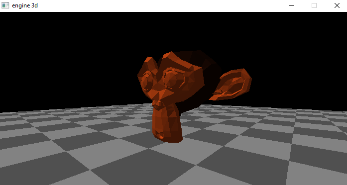

#  Software Renderer em C++ com Raylib
<br>
Uma engine 3D minimalista escrita do zero em C++, usando **apenas Raylib** para criar a janela e desenhar pixels/linhas/triângulos. Toda a matemática de projeção, view transform, culling e carregamento de modelos é implementada manualmente — sem uso de OpenGL, shaders ou bibliotecas de matemática 3D como GLM.

O objetivo é **aprender** como um pipeline 3D funciona por baixo do capô, camada por camada.

---

## ✨ Features implementadas

- ✅ **Projeção perspectiva** manual (fov, aspect ratio, viewport)
- ✅ **View transform** com translação e rotação (yaw) da câmera
- ✅ **Backface culling** por produto escalar entre normal da face e vetor até a câmera
- ✅ **Carregador de modelos 3D** em formato textual próprio (`.mdl`)
- ✅ **Câmera FPS** com WASD (movimento relativo à direção) e setas (rotação)
- ✅ **Física de pulo** simples com gravidade
- ✅ **Cores por face** (usado para debug visual e estilo)
- ✅ **Pitch (olhar para cima/baixo)**
- ✅ **Rotação de objetos**
- ✅ **Contorno preto estilo *cel shading* (drawOutlines)**
- ✅ **Iluminação flat por normal (`dot(normal, lightDir)`)**
- ✅ **Near-plane clipping (evitar "buracos" ao chegar perto de objetos)**
- ✅ **Chão e grid de referência**
- ✅ **Múltiplos objetos na cena**
- ✅ **Carregador de modelos 3D** Do tipo .OBJ e com suporta a cores solidas do arquivo .MTL

---

## 🚧 Em desenvolvimento / roadmap


---

## 🧠 Arquitetura

O pipeline de renderização segue a ordem clássica:

`mundo ──[WorldCam]──> câmera ──[PointPerspective]──> NDC ──[viewport]──> tela`

O projeto foi modularizado para facilitar a manutenção e escalabilidade:

### Estrutura de Pastas

```text
3d-engine/
├── include/          # Headers (.h) com as declarações de classes e funções
├── src/              # Implementações (.cpp) com a lógica das funções
├── models/           # Arquivos de modelo (.obj e .mtl)
└── main.cpp          # Ponto de entrada, loop do jogo e configuração da cena

## Compilação
### Windows
```
g++ main.cpp src/*.cpp -o main.exe -I include -L lib -lraylib -lopengl32 -lgdi32 -lwinmm
./main.exe
```
